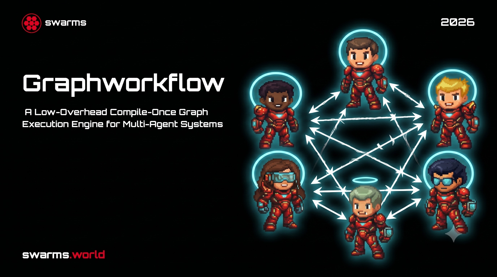

</img>

## GraphWorkflow

This repository holds the paper, examples, and benchmarks for <a href="https://github.com/kyegomez/swarms/blob/master/swarms/structs/graph_workflow.py">GraphWorkflow</a>, the graph orchestration engine in <a href="https://github.com/kyegomez/swarms">Swarms</a>. Agents are the nodes and edges carry their outputs. The graph is compiled once into a frozen plan of layers: topological generations, adjacency computed in one pass, and validation. Every run after that sweeps the plan as a wavefront over one shared thread pool. Layers with a single node skip the pool and run inline on the calling thread. Graph analysis can use either NetworkX or rustworkx, and the backend is never consulted while a workflow runs.

With no-op nodes, it is <a href="#benchmarks">5.9x faster than LangGraph</a> in steady state, 23-35x faster to compile, and imports in 231 ms. With real LLM calls the two reach parity, because model time dominates. The advantage shows up at scale, on cold starts, and in how little code a workflow takes.

[Paper (PDF)](./main.pdf) | [Examples](./examples/) | [Benchmarks](./benchmarks/) | [Discord](https://discord.gg/SSj7FyRSwy)

Kye Gomez, Adi Chaudhary, Ayaan Gazali, Steve-Dusty Wyatt Stanke · Swarms · November 2026

## Install

```bash
$ pip install swarms
```

To use the Rust graph backend, also install rustworkx:

```bash
$ pip install rustworkx
```

## Usage

```python
from swarms import Agent, GraphWorkflow

analyst    = Agent(agent_name = "Analyst",    model_name = "gpt-5.4")
writer     = Agent(agent_name = "Writer",     model_name = "gpt-5.4")
researcher = Agent(agent_name = "Researcher", model_name = "gpt-5.4")
editor     = Agent(agent_name = "Editor",     model_name = "gpt-5.4")

wf = GraphWorkflow()

for agent in (analyst, writer, researcher, editor):
    wf.add_node(agent)

wf.add_edge(analyst, writer)
wf.add_edge(analyst, researcher)
wf.add_edge(writer, editor)
wf.add_edge(researcher, editor)

results = wf.run("Produce a market report.")

# {'Analyst': ..., 'Writer': ..., 'Researcher': ..., 'Editor': ...}
```

You don't need a state schema, reducer, `START`/`END` edges, explicit `compile()` call, or recursion limit. GraphWorkflow infers entry and exit points from node degrees and compiles on first run. Writer and Researcher share a layer, so they run concurrently. Each node gets the task, then one chat message per predecessor output.

The [same workflow in LangGraph](./examples/diamond_langgraph.py) is shown next to the [GraphWorkflow version](./examples/diamond_graphworkflow.py) for comparison.

### Fan-out and fan-in

Bulk constructors add many edges at once, and the compiled plan is invalidated only once per call.

```python
from swarms import Agent, GraphWorkflow

lead    = Agent(agent_name = "Lead",  model_name = "gpt-5.4")
workers = [Agent(agent_name = f"Worker-{i}", model_name = "gpt-5.4") for i in range(4)]
judge   = Agent(agent_name = "Judge", model_name = "gpt-5.4")

wf = GraphWorkflow()
wf.add_nodes([lead, *workers, judge])

wf.add_edges_from_source(lead, workers)   # lead -> every worker
wf.add_edges_to_target(workers, judge)    # every worker -> judge

results = wf.run("Propose four pricing strategies, then pick the best one.")
```

To connect every node of one stage to every node of the next (a complete bipartite stage), use `add_parallel_chain`.

```python
wf.add_parallel_chain([drafter_a, drafter_b], [reviewer_a, reviewer_b])
```

### Declarative construction and the rustworkx backend

```python
from swarms import Agent, GraphWorkflow

planner  = Agent(agent_name = "Planner",  model_name = "gpt-5.4")
coder    = Agent(agent_name = "Coder",    model_name = "gpt-5.4")
reviewer = Agent(agent_name = "Reviewer", model_name = "gpt-5.4")

wf = GraphWorkflow.from_spec(
    agents  = [planner, coder, reviewer],
    edges   = [("Planner", "Coder"), ("Coder", "Reviewer")],
    backend = "rustworkx"      # topological generations computed in Rust
)

results = wf.run("Write a command line todo app.")
```

The backend only affects building and compiling the graph. Once compiled, both backends run the same frozen plan, so their run times are statistically indistinguishable.

### Concurrency

By default, every node in a layer runs at once, with the pool sized to the widest layer, because agent calls are network-bound. To stay under a provider's rate limit, set a cap.

```python
wf = GraphWorkflow(max_parallel_nodes = 8)
```

### Callbacks and streaming

Both hooks cost nothing unless you register them.

```python
def on_node_complete(node_id, output):
    print(f"[done] {node_id}")

def on_token(node_id, token):
    print(token, end = "", flush = True)

wf.run(
    "Summarize the quarter.",
    on_node_complete = on_node_complete,
    streaming_callback = on_token
)
```

### Checkpointing

After each layer finishes, its outputs are written to disk. If a run crashes and is restarted with the same task, finished layers are restored instead of being executed again, so at most one layer of work is lost.

```python
wf = GraphWorkflow(checkpoint_dir = "./checkpoints")

# ... add nodes and edges ...

wf.run("Audit the codebase.")              # crashes in layer 3? re-run it
wf.run("Audit the codebase.")              # layers 0-2 restored from disk

wf.clear_checkpoints("Audit the codebase.")
```

### Nested workflows

A `GraphWorkflow` can be added as a node in another one. The inner workflow runs its own compiled plan, and its results come back as one transcript.

```python
research_team = GraphWorkflow(name = "research-team")
research_team.add_nodes([searcher, summarizer])
research_team.add_edge(searcher, summarizer)

org = GraphWorkflow()
org.add_node(pm)
org.add_node(research_team)                # the whole team is one node
org.add_node(writer)

org.add_edge(pm, "research-team")
org.add_edge("research-team", writer)

results = org.run("Write a brief on solid-state batteries.")
```

### Iterative refinement

`max_loops` runs the whole graph several times. Each pass after the first starts from the exit-node outputs of the previous pass. The compiled plan and the thread pool are reused across passes.

```python
wf = GraphWorkflow(max_loops = 3)
wf.add_nodes([drafter, critic])
wf.add_edge(drafter, critic)

results = wf.run("Draft a launch announcement.")

# {'Drafter_loop_1': ..., 'Critic_loop_1': ..., ..., 'Drafter': ..., 'Critic': ...}
```

### Validate, inspect, save, load

```python
wf.validate(raise_on_error = True)         # cycles, unreachable nodes, dead ends - O(N + M)
wf.visualize_simple()                      # text rendering, including fan-out / fan-in patterns
wf.get_compilation_status()                # cached layers, worker sizing, compile timestamp
wf.usage                                   # token totals across all agents, including nested workflows

wf.save("workflow.json")                   # agent-free topology spec

wf = GraphWorkflow.load(
    "workflow.json",
    agent_registry = {"Drafter": drafter, "Critic": critic}
)
```

### Async

```python
results = await wf.arun("Produce a market report.")
```

## Benchmarks

Each node is a no-op, so the measured time is pure orchestration overhead. The suite covers five topologies (chain, wide, diamond, layered, tree) at 10, 50, and 200 nodes. Values are medians of 9 samples; the speedups below are geometric means over all 15 cells. Versions: swarms 17.0.0, LangGraph 1.0.4, Python 3.12, a 12-core Apple Silicon machine.

| phase | NetworkX backend | rustworkx backend |
|---|---|---|
| build | 2.4x | 2.7x |
| compile | 22.9x | 35.0x |
| first run (build + compile + run) | 7.0x | 7.6x |
| steady-state run | 5.9x (7.8x capped) | 6.2x (7.9x capped) |
| 200-node chain, steady state | 0.28 ms vs 17.14 ms, **60.2x** | |
| cold import | 231 ms vs 291 ms | |

"Capped" means `max_parallel_nodes = 11`. In the benchmark, layers far wider than the core count pay for creating that many threads; with real network-bound agents, that same width lets every call in the layer run at once.

Since swarms 14.0.0, cold import has dropped from 1,584 ms to 231 ms because graph libraries now load lazily. Steady-state runs are 17% faster on graphs whose layers fit within the core count. With real `gpt-5.4` agents, GraphWorkflow and LangGraph reach the same end-to-end latency: each model call takes seconds, while orchestration costs milliseconds.

```bash
$ python benchmarks/graph_workflow_bench.py                       # full suite -> benchmarks/results/latest.{json,md}
$ python benchmarks/graph_workflow_bench.py --lg-reducer counter --impls langgraph --skip-imports \
    --out benchmarks/results/langgraph_counter_reducer.json       # reducer ablation
$ python benchmarks/graph_workflow_bench.py --impls swarms-networkx,swarms-rustworkx --skip-imports \
    --max-parallel-nodes 11 --out benchmarks/results/swarms_capped_workers.json
$ OPENAI_API_KEY=... python benchmarks/agent_execution_bench.py   # real agents, paid calls
```

The [benchmarks README](./benchmarks/README.md) covers the methodology: how GC is handled, how imports are timed, the fairness controls, and environment provenance. Raw samples for every cell are in [`benchmarks/results/`](./benchmarks/results/).

## Todo

- [x] compile-once plan with an inline path for single-node layers
- [x] NetworkX and rustworkx backends
- [x] per-layer checkpointing, nested workflows, multi-loop refinement
- [x] lazy imports
- [x] layer-wide thread pool for network-bound fan-outs
- [ ] edge-triggered ready-set scheduler (removes the layer barrier when node latencies are skewed)
- [ ] native async execution (`arun` currently runs in a thread)
- [ ] conditional edges via compiled guard sub-plans
- [ ] distributed execution across processes and machines
- [ ] benchmarks at 10^3 - 10^4 nodes, with memory and CPU traces

## Citations

```bibtex
@article{gomez2026graphworkflow,
    title   = {GraphWorkflow: A Low-Overhead Compile-Once Graph Execution Engine for Multi-Agent Systems},
    author  = {Gomez, Kye and Chaudhary, Adi and Gazali, Ayaan and Stanke, Steve-Dusty Wyatt},
    year    = {2026},
    month   = {November},
    note    = {Swarms. Code and reproducibility artifacts available at \url{https://github.com/kyegomez/swarms}}
}
```

```bibtex
@article{kahn1962,
    author  = {Kahn, Arthur B.},
    title   = {Topological Sorting of Large Networks},
    journal = {Communications of the ACM},
    volume  = {5},
    number  = {11},
    pages   = {558--562},
    year    = {1962}
}
```

```bibtex
@inproceedings{malewicz2010pregel,
    author    = {Malewicz, Grzegorz and Austern, Matthew H. and Bik, Aart J.C. and Dehnert, James C. and Horn, Ilan and Leiser, Naty and Czajkowski, Grzegorz},
    title     = {Pregel: A System for Large-Scale Graph Processing},
    booktitle = {Proceedings of the 2010 ACM SIGMOD International Conference on Management of Data},
    pages     = {135--146},
    year      = {2010}
}
```

```bibtex
@article{treinish2022rustworkx,
    author  = {Treinish, Matthew and Carvalho, Ivan and Tsilimigkounakis, Georgios and Sa, Nahum},
    title   = {rustworkx: A High-Performance Graph Library for {Python}},
    journal = {Journal of Open Source Software},
    volume  = {7},
    number  = {79},
    pages   = {3968},
    year    = {2022}
}
```

```bibtex
@inproceedings{hagberg2008networkx,
    author    = {Hagberg, Aric A. and Schult, Daniel A. and Swart, Pieter J.},
    title     = {Exploring Network Structure, Dynamics, and Function using {NetworkX}},
    booktitle = {Proceedings of the 7th Python in Science Conference (SciPy 2008)},
    pages     = {11--15},
    year      = {2008}
}
```

## License

Apache 2.0. See [`LICENSE`](./LICENSE).
